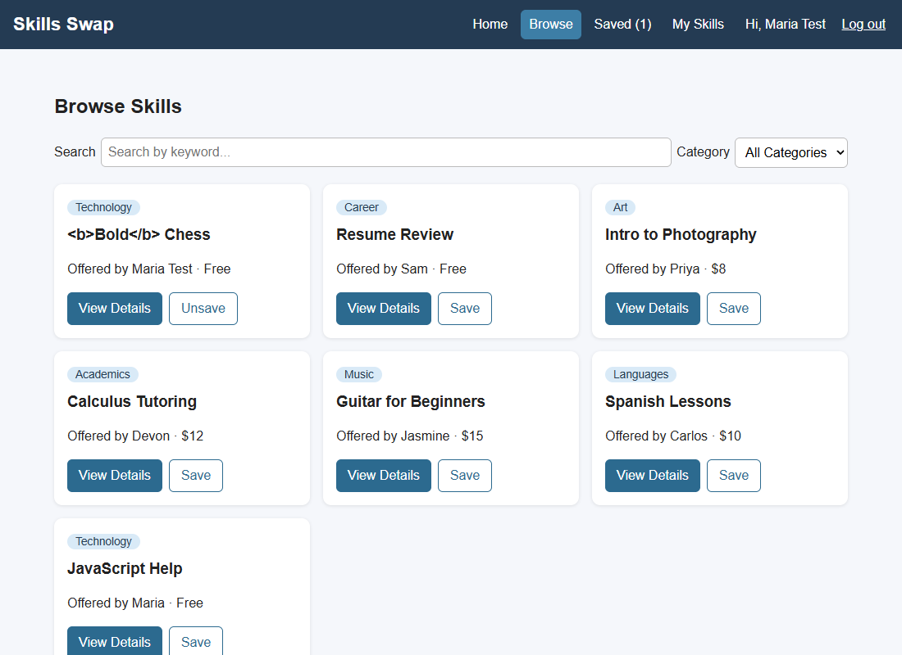
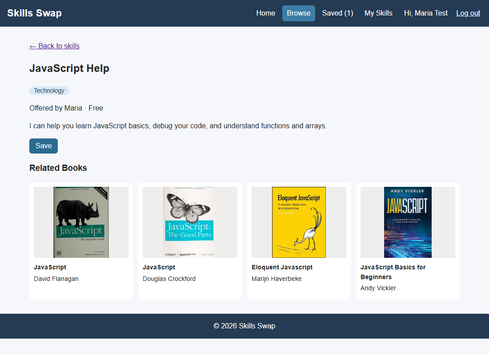
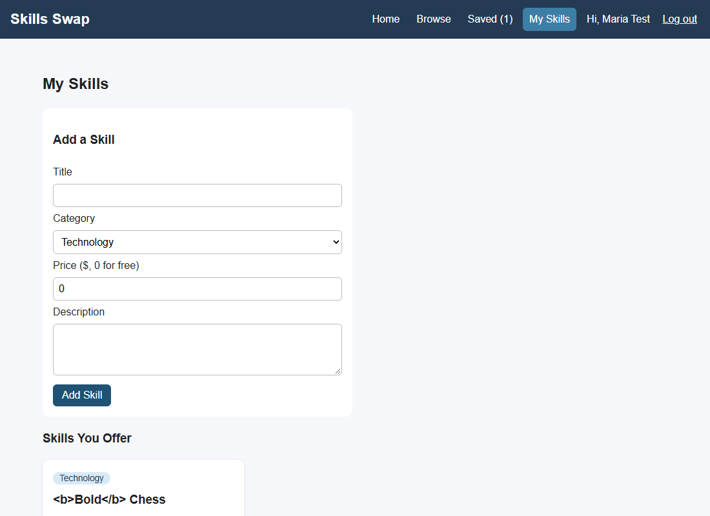
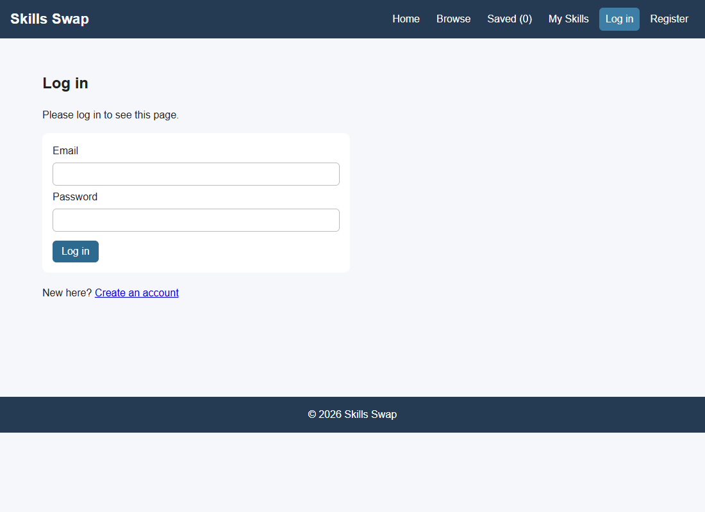
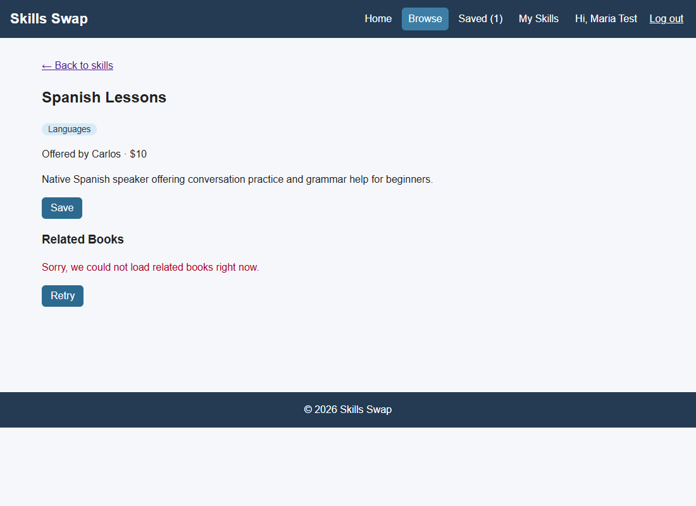
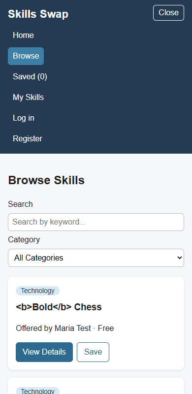

# Skills Swap (Final Project)

A React app where college students share skills and learn from each other.

- GitHub: https://github.com/albertovarg5/skills-swap-final-mvp
- Live site: https://skills-swap-final-mvp.vercel.app

## Problem
Students have useful skills (coding, languages, music) but no simple place to offer them or find help. Skills Swap lets anyone browse skills, and lets registered students save skills and post their own.

## Features
- Browse skills, search by keyword, filter by category (public, no account needed)
- Skill details page with related books from the [Open Library Search API](https://openlibrary.org/search.json)
- Register, log in, log out (real JWT authentication)
- Save / unsave skills (saved in the database, per user)
- Add your own skills (My Skills)
- Loading messages, error messages, and a **Retry** button when a request fails
- Responsive, mobile-first layout with a mobile menu

## Technology
| Part | Tools |
|---|---|
| Frontend | React 19, React Router, Context API (`AuthContext`, `SkillsContext`), `useState`/`useEffect`, PropTypes, Vite |
| Backend | Express (Node.js), runs as a Vercel Serverless Function in `api/` |
| Database | PostgreSQL (Neon via Vercel). Local development uses PGlite (embedded Postgres), so no install is needed |
| Auth/Security | `jsonwebtoken`, `bcryptjs`, `helmet`, `express-rate-limit`, `cookie-parser` |
| Testing | Vitest, React Testing Library, Supertest, ESLint |

**Why this architecture?** The app is already on Vercel, so the API lives in the same project (same domain). This avoids a second host and makes secure cookies and CSRF protection simple: there is no cross-site traffic at all. Postgres is the standard choice for users and saved skills; the Vercel Marketplace gives a free managed Neon database.

## Routes
| Route | Page | Access |
|---|---|---|
| `/` | Home | Public |
| `/skills` | Browse skills | Public |
| `/skills/:id` | Skill details + related books | Public |
| `/login` | Log in | Public |
| `/register` | Create account | Public |
| `/saved` | Saved skills | **Protected** |
| `/my-skills` | My skills + add form | **Protected** |
| `*` | 404 page | Public |

Visitors who open a protected page are sent to `/login` and returned to the page after logging in.

API endpoints (same origin, `/api`): `POST /auth/register`, `POST /auth/login`, `POST /auth/logout`, `GET /auth/me`, `GET /skills`, `POST /skills`*, `GET /saved`*, `PUT /saved/:id`*, `DELETE /saved/:id`* (*requires login).

## How authentication works
1. Register or log in. The server checks the input, hashes the password with bcrypt (or compares it), and creates a JWT that expires in **1 hour**.
2. The JWT is sent in an **HttpOnly cookie** (`Secure` in production, `SameSite=Strict`). JavaScript cannot read it, and it is never put in localStorage.
3. On every page load, `AuthContext` calls `GET /api/auth/me`. The server verifies the JWT signature and expiry, so sessions survive a refresh.
4. If the token expires while the user is using the app, the next request gets a 401. The app logs the user out and shows "Your session expired. Please log in again."
5. Logout clears the cookie on the server.
6. Every private endpoint verifies the JWT and only returns/changes the logged-in user's own data.

## External API
`src/services/bookService.js` calls Open Library for books related to a skill. It handles: loading state, errors (including network failures), empty results ("No related books found"), missing covers ("No cover"), missing authors ("Unknown author"), a **Retry** button, and stale responses (an `AbortController` plus an ignore flag stop an old request from replacing a newer one).

## Security measures
- Passwords hashed with bcrypt on the server; never returned by the API
- JWT verified on the server (HS256 only, expiry checked); secret only in an environment variable
- HttpOnly + Secure + SameSite=Strict cookie; token never in localStorage
- **CSRF**: (1) requests from another `Origin` are rejected, (2) every state-changing request must send an `X-CSRF-Token` header that matches a secret inside the JWT, (3) SameSite=Strict cookie
- **CORS**: no CORS headers are sent, so only the same origin can call the API
- Rate limiting on login and register (10 attempts per 15 minutes per IP)
- Input validation on the client and again on the server (`src/validation.js` is shared)
- **XSS**: React escapes all text; no `dangerouslySetInnerHTML`; external links are not built from user data; CSP and other security headers (`helmet` for the API, `vercel.json` for the site)
- Generic server error messages (details only in server logs); same message for wrong email and wrong password
- Parameterized SQL queries (no string-built SQL); 10 KB request size limit
- `.env` files are git-ignored; no secrets in `VITE_` variables

## Local setup
Requires Node.js 20+.
```
npm install
npm run dev:all      # starts the API (port 3001) and the React app (http://localhost:5173)
```
No `.env` is needed locally (embedded database, random dev JWT secret; data resets when the API restarts). To keep data between restarts set `PGLITE_DIR=.data`.

### Environment variables (names only)
| Name | Where | Purpose |
|---|---|---|
| `DATABASE_URL` | Server (required in production) | Postgres connection string |
| `JWT_SECRET` | Server (required in production) | Random string, 32+ characters |
| `ALLOWED_ORIGIN` | Server (optional) | Site origin for the CSRF origin check, e.g. the Vercel URL |

See `.env.example`. These are **not** `VITE_` variables, so they never reach the browser.

### Commands
```
npm run dev:all   # API + frontend
npm test          # all tests
npm run lint      # ESLint
npm run build     # production build
```

## Tests
Last run on my computer: **73 tests passed, 0 failed** (3 test files), `npm run lint` with no errors, `npm run build` succeeded.
- `server/app.test.js` (25): registration validation, bcrypt hash stored, login errors, logout, JWT expired/forged/`alg:none`, rate limit, protected endpoints, per-user saved skills, CSRF (missing/wrong token, bad origin), no CORS headers, safe errors
- `src/test/app.test.jsx` (28): the original 14 MVP tests plus Retry, stale responses, missing covers/authors, failed saves, price/XSS input, mobile menu
- `src/test/auth.test.jsx` (20): register/login/logout UI, validation, protected routes and redirects, session restore after refresh, expired token, no token in localStorage

The frontend tests run against the real Express API with an in-memory database (only Open Library is mocked). I also checked the main flows by hand in a real Edge browser (register, login, logout, protected redirect, saved skills after refresh, Retry with Open Library blocked, mobile menu).

## Screenshots
Home / Browse / Details / My Skills / Login / Retry error / Mobile:










## Deployment (Vercel)
1. Vercel project is connected to the GitHub repo (build `npm run build`, output `dist`).
2. In the Vercel dashboard: **Storage → Create Database → Neon (Postgres)** and connect it to this project. This adds `DATABASE_URL`.
3. **Settings → Environment Variables**: add `JWT_SECRET` (random, 32+ chars) for Production (and Preview).
4. Optional: add `ALLOWED_ORIGIN` = `https://skills-swap-final-mvp.vercel.app`.
5. Redeploy. The tables and the 6 sample skills are created automatically on the first request.
6. `vercel.json` sends all non-API routes to `index.html` (so refresh on `/skills/1` works) and sets security headers. `api/[...path].js` handles every `/api/*` request.

## Known limitations / future improvements
- The 1-hour session has no refresh token; users log in again after it expires.
- The rate limiter is in memory, so on serverless it is per instance (a shared store such as Redis would be stronger).
- "Email already exists" is shown at registration (a small account-enumeration trade-off for a clearer message).
- No email verification or password reset.
- Skills cannot be edited or deleted yet.
- Contact between students is not built yet (messages/requests).
- Open Library search quality varies, and some books have no cover.
