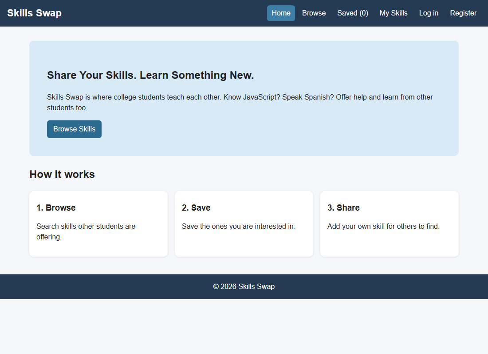
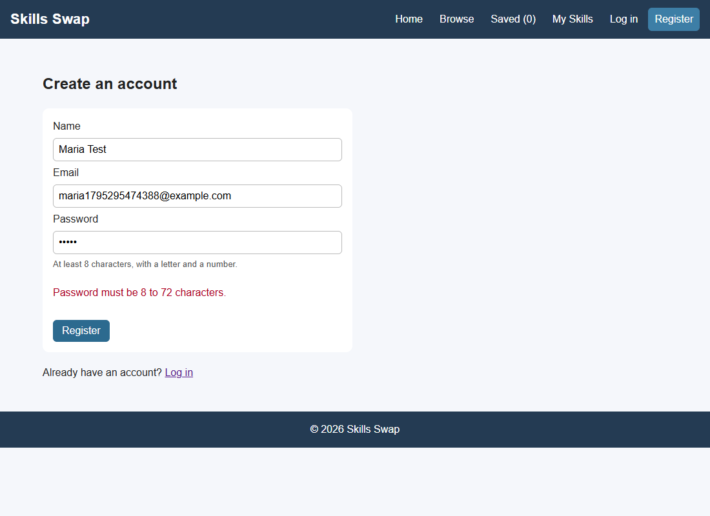

# Skills Swap (Final MVP)

A React single-page app where college students share skills and learn from each other.

## Features
- Browse skills, search by keyword, filter by category
- Skill details page with related books from the [Open Library Search API](https://openlibrary.org/search.json)
- Save / unsave skills and view them on the Saved page
- Add your own skill and see it on My Skills

## Routes
`/` Home, `/skills` Browse, `/skills/:id` Details, `/saved` Saved, `/my-skills` My Skills, `*` 404

## Tech
React, React Router, Context API (`useContext`), `useState` / `useEffect`, Vite, Vitest + React Testing Library.

## Live Site
https://skills-swap-final-mvp.vercel.app (deployed on Vercel from the `main` branch of this GitHub repo; every push redeploys automatically).

## Screenshots
Home page:



Browse skills (search and category filter):


Skill details with related books from Open Library:


Login and a registration validation error:




Mobile view (narrow screen, cards stack in one column):


## Run it
```
npm install
npm run dev
npm test
```

## Reused from earlier assignments
The skill data shape (title, category, price, description), the category filter idea, and the color palette.
The skill data shape is shared with the Unit 9 Express backend, which is now a real Express + Postgres API (`server/`).

## Backend and security
- Express 5 API: `/api/auth/register|login|logout|me`, `/api/skills`, `/api/saved`.
- Passwords hashed with bcrypt; sessions are a JWT in an `HttpOnly`, `SameSite` cookie (never in localStorage).
- CSRF token required on every state-changing request, Origin check, rate limiting on auth routes, `helmet` + CSP headers.
- All SQL is parameterized; React escapes user text (XSS test included).
- Frontend: `AuthContext`, login/register pages with validation, protected routes (redirect back after login), API retry, PropTypes.

## Run it with the backend
```
cp .env.example .env     # set JWT_SECRET (32+ chars)
npm run dev:all          # API on :3001 + Vite on :5173
```
Without `DATABASE_URL` the API uses an in-memory PGlite database (data resets on restart). Set `DATABASE_URL` to use real Postgres.

## Deployment (Vercel)
1. Repo imported in Vercel (Vite preset, build `npm run build`, output `dist`).
2. `vercel.json` sends `/api/*` to the serverless function in `api/index.js` and every other route to `index.html`.
3. Required environment variables in Vercel: `DATABASE_URL` (hosted Postgres, e.g. Neon), `JWT_SECRET` (32+ random chars), `NODE_ENV=production`.

## Testing
`npm test` runs 73 tests (Vitest, React Testing Library, Supertest): API registration/login/JWT/CSRF/rate limit, protected routes, session expiry, validation, XSS, retry, search/filter, saving, and the books API error case. `npm run lint` and `npm run build` pass.

## Known Issues
- Free-tier serverless cold starts make the first request slow.
- My Skills can add skills but cannot edit or delete them yet.
- Some books have no cover ("No cover" box); if Open Library is down an error message shows instead of books.

## Future Improvements
- Edit and delete buttons for My Skills.
- Messaging / request help, and reviews after a session.
- Password reset by email.
