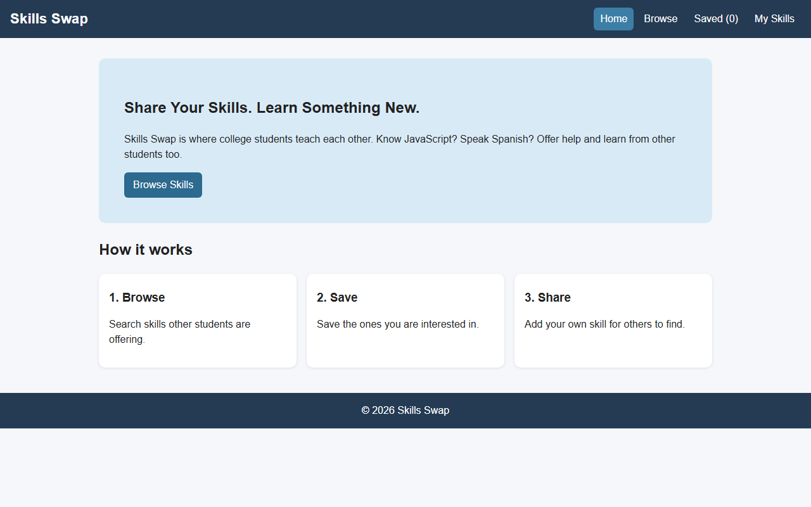
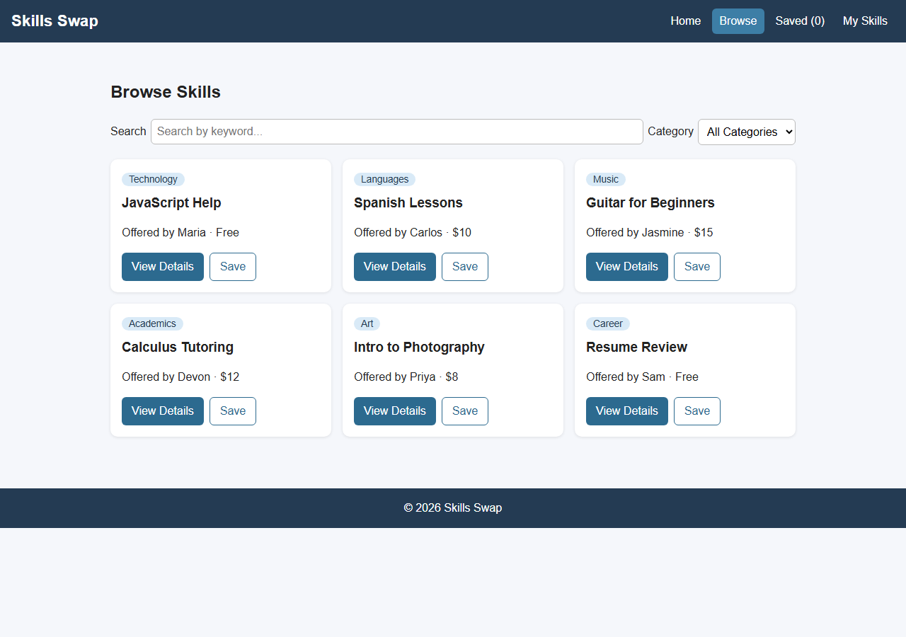
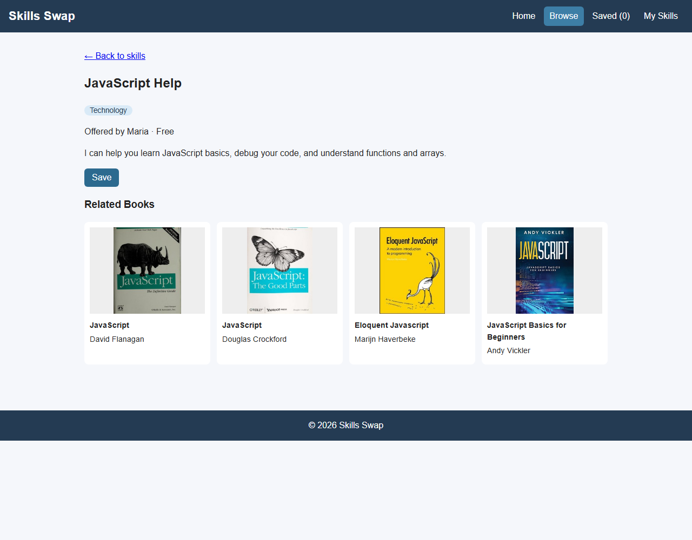
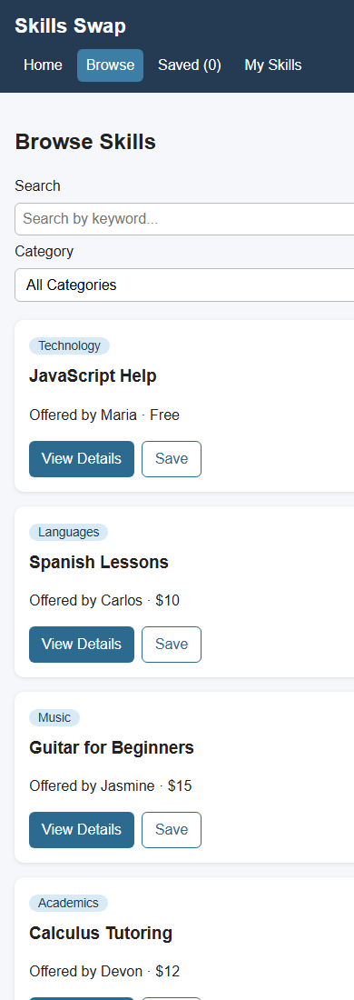

# Skills Swap (Final MVP)

A React single-page app where college students share skills and learn from each other.

## Features
- Browse skills, search by keyword, filter by category
- Skill details page with related books from the [Open Library Search API](https://openlibrary.org/search.json)
- Save / unsave skills and view them on the Saved page
- Add your own skill and see it on My Skills

## Routes
`/` Home, `/skills` Browse, `/skills/:id` Details, `/saved` Saved, `/my-skills` My Skills, `*` 404

## Tech
React, React Router, Context API (`useContext`), `useState` / `useEffect`, Vite, Vitest + React Testing Library.

## Live Site
https://skills-swap-final-mvp.vercel.app (deployed on Vercel from the `main` branch of this GitHub repo; every push redeploys automatically).

## Screenshots
Home page:



Browse skills (search and category filter):



Skill details with related books from Open Library:



Mobile view (narrow screen, cards stack in one column):



## Run it
```
npm install
npm run dev
npm test
```

## Reused from earlier assignments
The skill data shape (title, category, price, description), the category filter idea, and the color palette.
The Unit 9 Express backend was replaced with local sample data so the app can be deployed on Vercel.

## Deployment
1. Pushed the project to GitHub.
2. Imported the repo in Vercel (Vite preset, build command `npm run build`, output folder `dist`).
3. `vercel.json` sends every route to `index.html` so links like `/skills/1` still work when refreshed.

## Testing
`npm test` runs 14 Vitest + React Testing Library tests (pages, search/filter, saving, adding skills, and the books API including the error case). I also checked the live site by hand: all pages load, books show covers and authors, and saved skills stay after a refresh.

## Known Issues
- There is no backend, so skills and saved items are only stored in this browser (localStorage). Other students cannot see my skills.
- My Skills can add skills but cannot edit or delete them yet (my wireframe had Edit/Delete).
- Some books have no cover, so a "No cover" box is shown. Book results are only as good as Open Library's search.
- If Open Library is slow or down, an error message shows instead of books.
- No login, so "Offered by" names are just sample data.

## Future Improvements
- Edit and delete buttons for My Skills.
- Node.js backend and database so skills are shared between students.
- Login so people can only edit their own skills.
- Messaging / request help, and reviews after a session.
